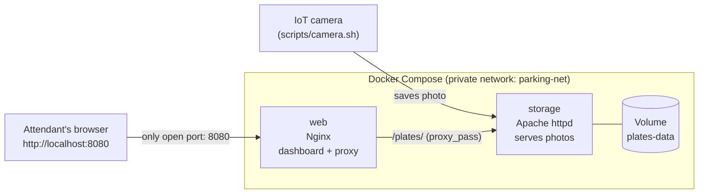

# Retro Rides - Smart Parking License Plate Tracker


A "smart parking lot" for **classic cars**. An IoT camera at the gate photographs every license plate and saves the photo on a storage server. The attendant opens a live dashboard that shows every car in the lot, how long it has been parked and how much it owes.

This is **Track 1 - Lite** of the DevOps assignment: two micro-services orchestrated with **Docker Compose**, photos kept in a **Docker Volume**, and a **GitHub Actions** pipeline that checks the build on every push and publishes the images to **GitHub Container Registry**.

> Team: Adam Bronshtein, _(add teammate names here)_

---

## Architecture



| Service | Image | Job |
|---|---|---|
| `web` | Nginx 1.27 (alpine) | Serves the dashboard (HTML/CSS/JS). Forwards `/plates/...` requests to `storage`. |
| `storage` | Apache httpd 2.4 (alpine) | Stores the plate photos and serves them. Shows the folder as a web page so the dashboard can discover new photos. |
| `plates-data` | Docker named Volume | Keeps the photos alive when the containers are removed. |

Only port **8080** (Nginx) is published. Apache is reachable only inside the Docker network.

Design decisions are explained in [ARCHITECTURE.md](ARCHITECTURE.md).

---

## Quick start

Requirements: Docker Desktop (or Docker Engine + Compose v2). Nothing else.

```bash
git clone <this repository>
cd <repository folder>
docker compose up --build
```

Open **http://localhost:8080**. The lot starts with 4 classic cars already parked.

### Send a new car through the gate

In a second terminal, pretend to be the camera:

```bash
# macOS / Linux / Git Bash
./scripts/camera.sh               # a random car
./scripts/camera.sh MUSTANG-65    # a specific car
./scripts/camera.sh --list        # all available cars
```

```powershell
# Windows PowerShell
.\scripts\camera.ps1
.\scripts\camera.ps1 MUSTANG-65
.\scripts\camera.ps1 -List
```

If PowerShell says the script is not digitally signed, allow scripts for this window only and run it again:

```powershell
Set-ExecutionPolicy -Scope Process Bypass
```

The new car appears on the dashboard within about 3 seconds, with a pop-up and a funny message. No page refresh needed.

### Prove the Volume works (the live demo)

```bash
docker compose down        # containers and network are removed...
docker compose up -d       # ...and started again
```

Refresh the dashboard: **all cars are still there**, and their parking time kept counting. The photos live in the Volume, not in the containers.

```bash
docker volume ls                          # you will see smart-parking_plates-data
docker compose down -v                    # -v deletes the Volume too: the lot is "reset" to the 4 starting cars
```

---

## Our own touch: the Classic Cars Lot

| Feature | What it does |
|---|---|
| Retro theme | 1950s diner look, chrome bumper photos, vintage plates |
| Funny arrival message | Every car that arrives gets a pop-up joke (the same car always gets the same joke) |
| Hourly price | 12 NIS per started hour, first 10 minutes free. The price updates live every second |
| Full Capacity Alert | The lot has 6 spots. When it is full a flashing red banner appears; over capacity it counts the extra cars |
| Release car button | Marks a car as gone and frees its spot (remembered in the browser) |
| Dark Mode | Diner by day, drive-in by night. Remembered in the browser |
| Honk | Optional "beep beep" sound when a car arrives (button in the top bar) |
| Easter egg | Type `vroom` or enter the Konami code (up up down down left right left right B A) on the dashboard |

---

## Project structure

```
.
├── docker-compose.yml          # the whole system: 2 services, 1 volume, 1 network
├── web/
│   ├── Dockerfile              # Nginx + dashboard files
│   ├── nginx.conf              # serves the page, proxies /plates/ to storage
│   └── html/                   # index.html, style.css, app.js
├── storage/
│   ├── Dockerfile              # Apache + config + first-run seeding
│   ├── plates.conf             # directory listing for /plates/
│   ├── entrypoint.sh           # seeds the Volume on the very first start only
│   └── seed/                   # the 4 starting photos
├── camera-samples/             # photos the fake camera script can "capture"
├── scripts/
│   ├── camera.sh / camera.ps1  # fake IoT camera
│   ├── smoke-test.sh           # checks that the running system works (used by CI too)
│   └── generate_plates.py      # how the plate photos were generated
├── .github/workflows/ci.yml    # CI/CD pipeline
├── AI_USAGE.md                 # how we used AI + mistakes it made
└── ARCHITECTURE.md             # architectural decisions
```

### How a photo travels

1. The camera saves `YYYYMMDD-HHMMSS_PLATE.png` (UTC time) into the Volume. The file name **is** the arrival time.
2. Apache shows that folder as a web page (directory listing).
3. The dashboard's JavaScript downloads that page through Nginx every 3 seconds, finds the photo names, and builds/updates the cards.

---

## CI/CD (GitHub Actions)

File: [`.github/workflows/ci.yml`](.github/workflows/ci.yml)

| Job | When | What |
|---|---|---|
| **Docker build check** | every push, every pull request | validates `docker-compose.yml`, lints both Dockerfiles (hadolint), builds both images, starts the stack, waits until it is healthy, then runs `scripts/smoke-test.sh` (dashboard, Nginx -> Apache proxy, seeded cars, photo download, read-only check, security headers) |
| **Publish images to GHCR** (bonus) | push to `main` or a `v*.*.*` tag, after the build job passed | logs in to `ghcr.io` with the built-in `GITHUB_TOKEN`, tags the images automatically, builds for **amd64 and arm64** (PCs, Apple Silicon, Windows on ARM, Raspberry Pi) and pushes them |

### Image tags

| Event | Tags created |
|---|---|
| `git tag v1.2.0 && git push --tags` | `1.2.0`, `1.2`, `sha-<commit>`, `build-<run number>` |
| push to `main` | `latest`, `sha-<commit>`, `build-<run number>` |

Published images (lowercase owner/repo):

```
ghcr.io/<owner>/<repo>-web
ghcr.io/<owner>/<repo>-storage
```

```bash
docker pull ghcr.io/<owner>/<repo>-web:latest
```

---

## Test it yourself

```bash
docker compose up -d --wait
./scripts/smoke-test.sh          # run in Git Bash, macOS or Linux: 6 checks, prints PASS/FAIL
```

The CI pipeline runs exactly the same script, so "works on my machine" and "works in CI" mean the same thing.

## Useful commands

```bash
docker compose ps                       # status and health of both services
docker compose logs -f storage          # Apache + seeding messages
docker compose exec storage ls /usr/local/apache2/htdocs/plates   # the photos inside the Volume
docker volume inspect smart-parking_plates-data
docker compose up -d --build            # rebuild after changing code
```

## Known limitations

- "Release car" is remembered in the browser only. The photos stay in the Volume as the camera's record.
- Photo times are read from the file name. A camera that does not follow the naming convention will be ignored by the dashboard.
- The lot is not password protected (it is a class project).

## For the team

- Hebrew summary for teammates: [docs/TEAM_SUMMARY_HE.md](docs/TEAM_SUMMARY_HE.md)
- Live demo script: [docs/DEMO_SCRIPT.md](docs/DEMO_SCRIPT.md)
- Code Review prep: [docs/CODE_REVIEW_PREP.md](docs/CODE_REVIEW_PREP.md)
- What is left to do: [docs/TEAM_CHECKLIST.md](docs/TEAM_CHECKLIST.md)

## AI usage

See [AI_USAGE.md](AI_USAGE.md).
