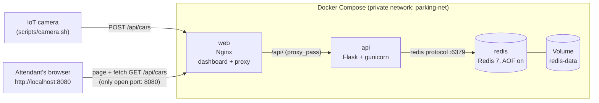

# Retro Rides - Smart Parking License Plate Tracker


A "smart parking lot" for **classic cars**. An IoT camera at the gate reports every license plate to an API. The attendant opens a live dashboard that shows every car in the lot, how long it has been parked and how much it owes.

This is **Track 2 - Full Stack DevOps** of the DevOps assignment: three services (**Nginx** web, **Flask API**, **Redis** database) orchestrated with **Docker Compose**, the Redis data kept in a **Docker Volume**, and a **GitHub Actions** pipeline that checks the build on every push and publishes the images to **GitHub Container Registry**.

> Team: Adam Bronshtein, Ofir Moshe, Gal Rotem, Itay Cohen
>
> History: version 1 was built as Track 1 - Lite (Nginx + Apache). See [docs/track2-changes.md](docs/track2-changes.md).

---

## Architecture



| Service | Image | Job |
|---|---|---|
| `web` | Nginx 1.27 (alpine) | Serves the dashboard (HTML/CSS/JS) and the car photos. Forwards `/api/...` to `api`. |
| `api` | Python 3.12 (alpine) + Flask + gunicorn | `POST /api/cars` for the camera, `GET /api/cars` for the dashboard, `DELETE /api/cars/<plate>` to release a car. |
| `redis` | Redis 7 (alpine) | The database: cars inside, arrival times, total cars that entered. |
| `redis-data` | Docker named Volume | Redis writes its data file (`--appendonly yes`) here, so data survives when the containers are removed. |

Only port **8080** (Nginx) is published. The API and Redis are reachable only inside the Docker network.

Design decisions are explained in [ARCHITECTURE.md](ARCHITECTURE.md).

---

## Quick start

Requirements: Docker Desktop (or Docker Engine + Compose v2). Nothing else.

```bash
git clone <this repository>
cd <repository folder>
docker compose up --build
```

Open **http://localhost:8080**. The lot starts with 4 classic cars already parked (the API adds them once, the first time).

### Send a new car through the gate

In a second terminal, pretend to be the camera:

```bash
# macOS / Linux / Git Bash
./scripts/camera.sh               # a random car
./scripts/camera.sh MUSTANG-65    # a specific car
./scripts/camera.sh --list        # cars that have a photo
```

```powershell
# Windows PowerShell
.\scripts\camera.ps1
.\scripts\camera.ps1 MUSTANG-65
.\scripts\camera.ps1 -List
```

If PowerShell says the script is not digitally signed, allow scripts for this window only and run it again:

```powershell
Set-ExecutionPolicy -Scope Process Bypass
```

Under the hood the camera does just this (you can do it by hand):

```bash
curl -X POST -H "Content-Type: application/json" -d '{"plate":"MUSTANG-65"}' http://localhost:8080/api/cars
curl http://localhost:8080/api/cars
```

The new car appears on the dashboard within about 3 seconds, with a pop-up and a funny message. No page refresh needed.

### API

| Method + path | Who uses it | Answer |
|---|---|---|
| `POST /api/cars` body `{"plate":"MUSTANG-65"}` | camera | `201` created, `409` already in the lot, `400` invalid plate (A-Z, 0-9, dash, 2-12 chars) |
| `GET /api/cars` | dashboard | `{"capacity":6,"parked":4,"total_entered":4,"cars":[{"plate":"...","arrived_at":<unix seconds>}]}` newest first |
| `DELETE /api/cars/<plate>` | dashboard (Release button) | `204` released, `404` no such car |
| `GET /api/health` | Docker health check | `200` when Redis answers |

### Prove the Volume works (the live demo)

```bash
docker compose down        # containers and network are removed...
docker compose up -d       # ...and started again
```

Refresh the dashboard: **all cars are still there**, and their parking time kept counting. Redis saved its data in the Volume, not in the container.

```bash
docker volume ls                          # you will see smart-parking_redis-data
docker compose down -v                    # -v deletes the Volume too: the lot is "reset" to the 4 starting cars
```

---

## Our own touch: the Classic Cars Lot

| Feature | What it does |
|---|---|
| Retro theme | 1950s diner look, chrome bumper photos, vintage plates |
| Funny arrival message | Every car that arrives gets a pop-up joke (the same car always gets the same joke) |
| Hourly price | 12 NIS per started hour, first 10 minutes free. The price updates live every second |
| Full Capacity Alert | The lot has 6 spots. When it is full a flashing red banner appears; over capacity it counts the extra cars |
| Release car button | Sends `DELETE` to the API: the car is removed from Redis and the spot is free |
| Dark Mode | Diner by day, drive-in by night. Remembered in the browser |
| Honk | Optional "beep beep" sound when a car arrives (button in the top bar) |
| Easter egg | Type `vroom` or enter the Konami code (up up down down left right left right B A) on the dashboard |

---

## Project structure

```
.
├── docker-compose.yml          # the whole system: 3 services, 1 volume, 1 network
├── web/
│   ├── Dockerfile              # Nginx + dashboard files
│   ├── nginx.conf              # serves the page, proxies /api/ to the API
│   └── html/                   # index.html, style.css, app.js, cars/ (photos)
├── api/
│   ├── Dockerfile              # Python + Flask + gunicorn, runs as a normal user
│   ├── requirements.txt        # pinned versions
│   └── app.py                  # the 4 endpoints + Redis logic
├── scripts/
│   ├── camera.sh / camera.ps1  # fake IoT camera (HTTP POST)
│   ├── smoke-test.sh           # checks that the running system works (used by CI too)
│   ├── persistence-test.sh     # down + up, then checks the data is still there (used by CI too)
│   └── generate_plates.py      # how the plate photos were generated
├── .github/workflows/ci.yml    # CI/CD pipeline
├── AI_USAGE.md                 # how we used AI + mistakes it made
└── ARCHITECTURE.md             # architectural decisions
```

### How a car travels

1. The camera sends `POST /api/cars` with the plate. Nginx forwards it to the API.
2. The API checks the plate, then stores it in Redis: a hash `parking:cars` (plate -> arrival time) and a counter `parking:total`.
3. Redis appends every change to its AOF file in `/data`, which is the Volume.
4. The dashboard's JavaScript calls `fetch("/api/cars")` every 3 seconds and builds / updates / removes the cards.

---

## CI/CD (GitHub Actions)

File: [`.github/workflows/ci.yml`](.github/workflows/ci.yml)

| Job | When | What |
|---|---|---|
| **Docker build check** | every push, every pull request | validates `docker-compose.yml`, lints both Dockerfiles (hadolint), builds the images, starts the stack and waits until it is healthy, runs `scripts/smoke-test.sh` (dashboard, proxy, POST/GET/DELETE, validation, photo, security headers) and `scripts/persistence-test.sh` (`down` + `up`, the data must survive) |
| **Publish images to GHCR** (bonus) | push to `main` or a `v*.*.*` tag, after the build job passed | logs in to `ghcr.io` with the built-in `GITHUB_TOKEN`, tags the images automatically, builds for **amd64 and arm64** and pushes `web` and `api` (Redis uses the official image) |

### Image tags

| Event | Tags created |
|---|---|
| `git tag v2.0.0 && git push --tags` | `2.0.0`, `2.0`, `sha-<commit>`, `build-<run number>` |
| push to `main` | `latest`, `sha-<commit>`, `build-<run number>` |

Published images (lowercase owner/repo):

```
ghcr.io/<owner>/<repo>-web
ghcr.io/<owner>/<repo>-api
```

---

## Test it yourself

```bash
docker compose up -d --wait
./scripts/smoke-test.sh          # Git Bash, macOS or Linux: 7 checks, prints PASS/FAIL
./scripts/persistence-test.sh    # runs down + up and checks the data survived
```

The CI pipeline runs exactly the same scripts, so "works on my machine" and "works in CI" mean the same thing.

## Useful commands

```bash
docker compose ps                       # status and health of the 3 services
docker compose logs -f api              # API requests
docker compose exec redis redis-cli HGETALL parking:cars    # the cars, straight from the database
docker compose exec redis redis-cli GET parking:total
docker volume inspect smart-parking_redis-data
docker compose up -d --build            # rebuild after changing code
```

## Known limitations

- The lot is not password protected (it is a class project).
- The 6 parking spots (capacity) are a constant in the code; the lot does not refuse a 7th car, it shows "over capacity".
- Car photos exist only for the sample cars. For any other plate the dashboard draws a plate picture itself.

## For the team

- Hebrew summary for teammates: [docs/TEAM_SUMMARY_HE.md](docs/TEAM_SUMMARY_HE.md)
- What changed from Track 1: [docs/track2-changes.md](docs/track2-changes.md)
- Live demo script: [docs/DEMO_SCRIPT.md](docs/DEMO_SCRIPT.md)
- Code Review prep: [docs/CODE_REVIEW_PREP.md](docs/CODE_REVIEW_PREP.md)
- What is left to do: [docs/TEAM_CHECKLIST.md](docs/TEAM_CHECKLIST.md)

## AI usage

See [AI_USAGE.md](AI_USAGE.md).
